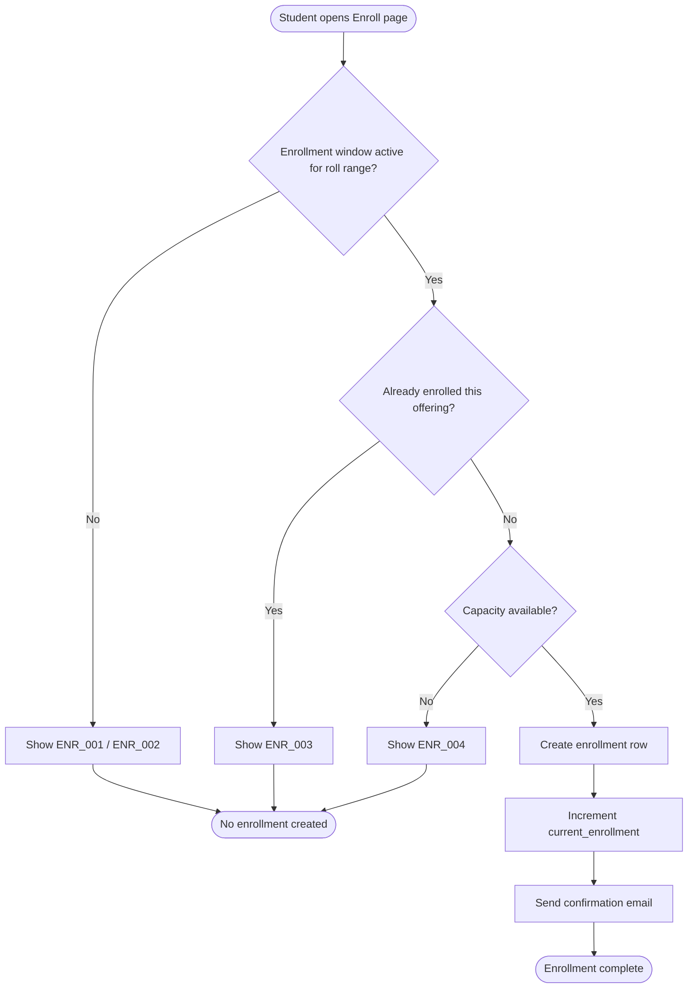
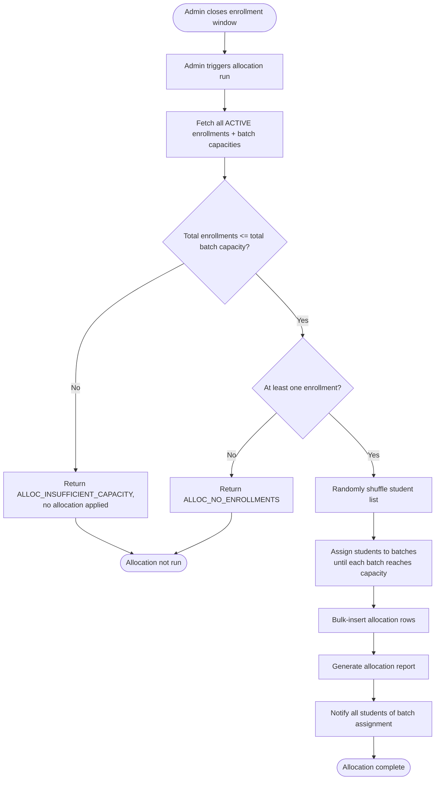
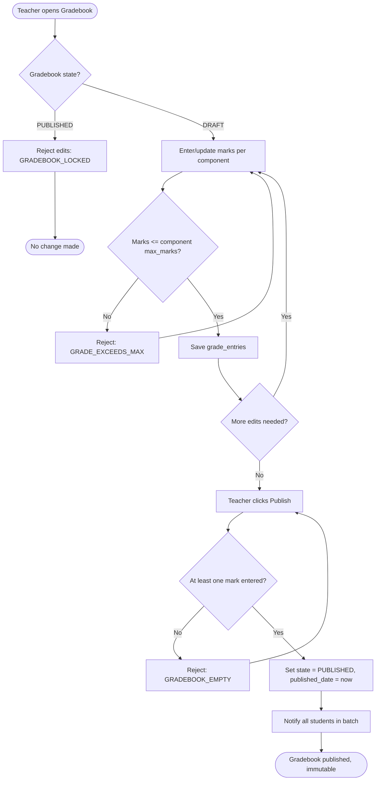

# UML — Activity Diagrams

## Overview

Mermaid `flowchart` renderings of the key multi-step workflows described in [Enrollment Design](../SDD/04-Enrollment-Design.md), [Batch Allocation](../SDD/05-Batch-Allocation.md), and [Teacher Workspace — Gradebook](../SDD/06-Teacher-Workspace.md#6-gradebook-sub-module).

## 1. Enrollment Activity

## 2. Batch Allocation Activity

## 3. Gradebook Draft-to-Publish Activity

## Related Documents

- [Enrollment Design](../SDD/04-Enrollment-Design.md)
- [Batch Allocation](../SDD/05-Batch-Allocation.md)
- [Teacher Workspace](../SDD/06-Teacher-Workspace.md)
- [Sequence Diagrams](04-Sequence-Diagrams.md)
- [State Diagram](08-State-Diagram.md)
