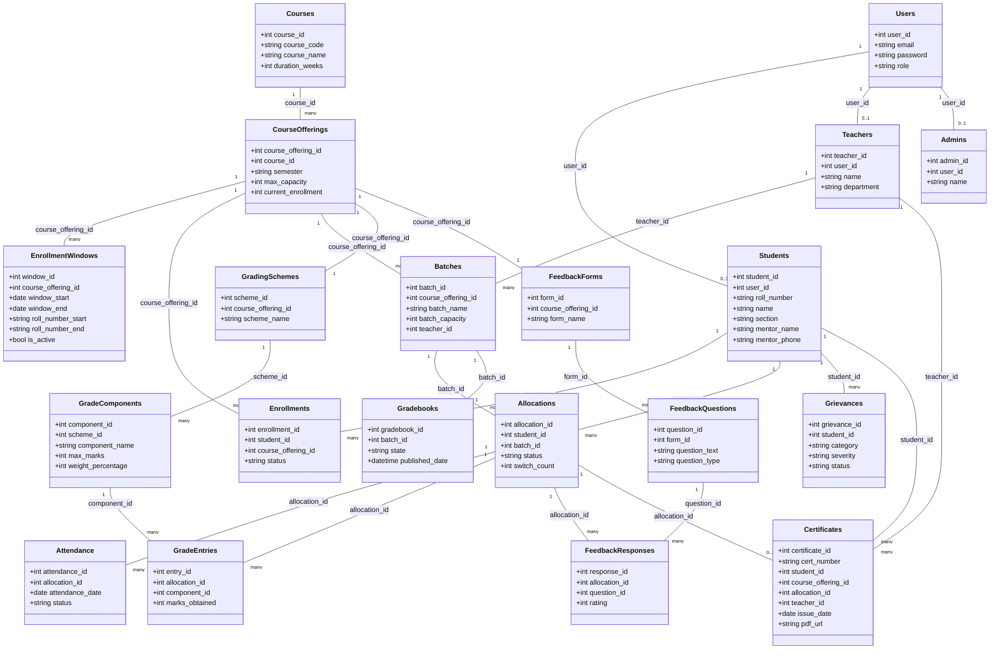

# UML — Class Diagram

## Overview

Mermaid class diagram reflecting the 20 tables defined in [Database Design](../SDD/02-Database-Design.md). Attributes are abbreviated to the fields relevant for understanding relationships; see Database Design for full column lists, types, and constraints. This diagram does not introduce any table, column, or relationship not already present in Database Design.

## Notes

- `Students`, `Teachers`, and `Admins` are **not** subclasses of `Users` in an OOP-inheritance sense — each holds its own `user_id` foreign key back to `Users` (a 1-to-0..1 association), exactly as defined in [Database Design §4.1–4.4](../SDD/02-Database-Design.md#4-table-definitions). The diagram intentionally uses association, not inheritance arrows, to stay accurate to the actual schema.
- `mentor_name` / `mentor_phone` on `Students` are plain attributes with no relationship line — there is no `Mentor` class, consistent with the fix in [Database Design §4.2](../SDD/02-Database-Design.md#42-students-table).
- **Known documentation gap** (not fixed here, as it would require designing new schema rather than documenting existing schema): a `SwitchRequest` concept is referenced by the batch-switching workflow in [Batch Allocation §6](../SDD/05-Batch-Allocation.md#6-batch-switching) and by `POST /student/allocation/{allocationId}/switch` / `GET /admin/switch-requests` in the API docs, but no `switch_requests` table is defined in [Database Design](../SDD/02-Database-Design.md). It is intentionally omitted from this class diagram rather than invented. Flagging this for the engineering team to resolve in Database Design is recommended.

## Related Documents

- [Database Design](../SDD/02-Database-Design.md)
- [ER Diagram](03-ER-Diagram.md)
