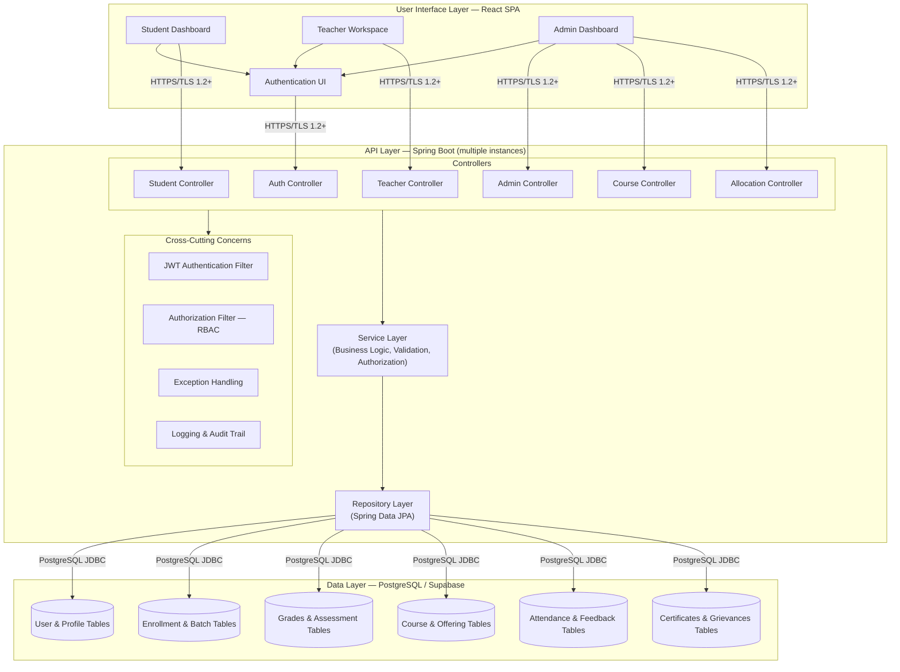

# UML — Component Diagram

## Overview

Mermaid rendering of the layered component structure described in [System Architecture §3–4](../SDD/01-System-Architecture.md#3-system-architecture-diagram). Reflects the same layers, controllers, and cross-cutting concerns — no new components introduced.

## Notes

- The **Cross-Cutting Concerns** block (JWT filter, RBAC filter, exception handling, audit logging) wraps every controller, per [System Architecture §3](../SDD/01-System-Architecture.md#3-system-architecture-diagram) — shown here as a shared dependency rather than duplicated per-controller for legibility.
- The Service and Repository layers are shared across all controllers (standard layered architecture), not one-per-controller.

## Related Documents

- [System Architecture](../SDD/01-System-Architecture.md)
- [Deployment Diagram](07-Deployment-Diagram.md)
