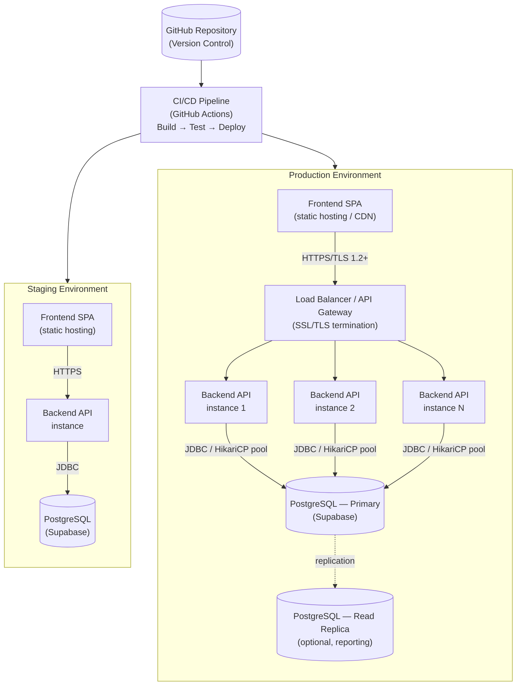

# UML — Deployment Diagram

## Overview

Mermaid rendering of the deployment topology in [System Architecture §11](../SDD/01-System-Architecture.md#11-deployment-architecture) and the scaling notes in [System Architecture §10](../SDD/01-System-Architecture.md#10-scalability-considerations).

## Notes

- Backend instances are **stateless** (JWT-based sessions, no server-side session store), so the load balancer needs no session affinity — see [System Architecture §2.2](../SDD/01-System-Architecture.md#22-stateless-design) and [§10.1](../SDD/01-System-Architecture.md#101-horizontal-scaling).
- The read replica is explicitly **optional**, used only for reporting workloads per [System Architecture §10.2](../SDD/01-System-Architecture.md#102-database-scaling) — it is not required for the MVP to function.
- Both environments use the same topology at different scale; Staging typically runs a single backend instance.

## Related Documents

- [System Architecture](../SDD/01-System-Architecture.md)
- [Component Diagram](06-Component-Diagram.md)
