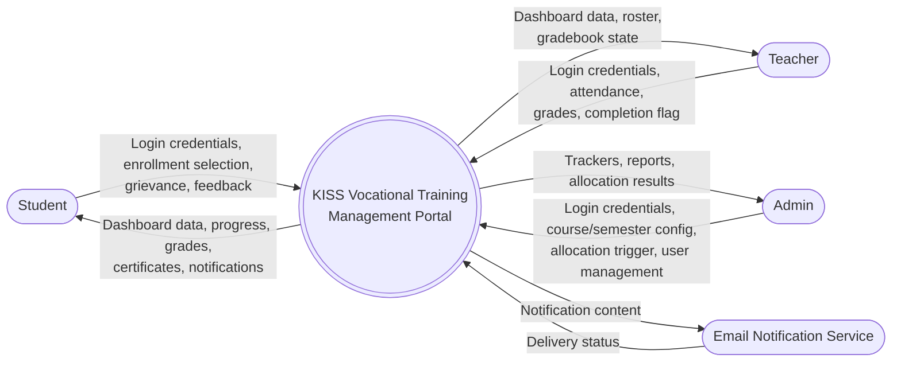

# UML — Data Flow Diagram, Level 0 (Context Diagram)

## Overview

The system-as-a-single-process context diagram: external entities (actors) and the data flows into/out of the KISS VTMP system as a whole. Mermaid has no native DFD notation, so this uses `flowchart` conventions: rounded rectangles for external entities, a circle for the process, consistent with [DFD Level 1](10-DFD-Level1.md).

## Notes

- This is the system boundary view: everything inside the single process circle is expanded one level down in [DFD Level 1](10-DFD-Level1.md).
- The **Email Notification Service** is the one external system the portal integrates with (enrollment confirmations, allocation results, grade publication, certificate issuance) — see the async notification steps in [Sequence Diagrams](04-Sequence-Diagrams.md).

## Related Documents

- [DFD Level 1](10-DFD-Level1.md)
- [System Architecture](../SDD/01-System-Architecture.md)
