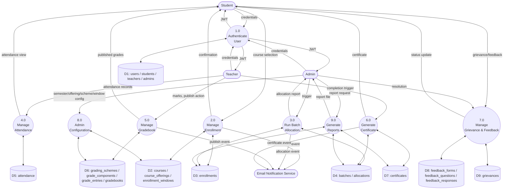

# UML — Data Flow Diagram, Level 1

## Overview

Expands the single process in [DFD Level 0](09-DFD-Level0.md) into its major sub-processes and data stores, matching the module boundaries in [SDD Index](../SDD/SDD-Index.md). Notation: circles = processes, rounded rectangles = external entities, open rectangles = data stores (tables from [Database Design](../SDD/02-Database-Design.md)).

## Notes

- Data stores (D1–D9) group the 20 tables from [Database Design §4](../SDD/02-Database-Design.md#4-table-definitions) by the process that primarily owns them; several tables are read by more than one process (e.g. `allocations` is written by 3.0 and read by 4.0/5.0/6.0), shown via the process-to-store arrows relevant to each.
- Process numbering (1.0–9.0) corresponds one-to-one with the primary module documents: 2.0 → [Enrollment Design](../SDD/04-Enrollment-Design.md), 3.0 → [Batch Allocation](../SDD/05-Batch-Allocation.md), 4.0/5.0/6.0 → [Teacher Workspace](../SDD/06-Teacher-Workspace.md), 8.0 → [Admin Dashboard](../SDD/08-Admin-Dashboard.md).

## Related Documents

- [DFD Level 0](09-DFD-Level0.md)
- [Database Design](../SDD/02-Database-Design.md)
- [SDD Index](../SDD/SDD-Index.md)
