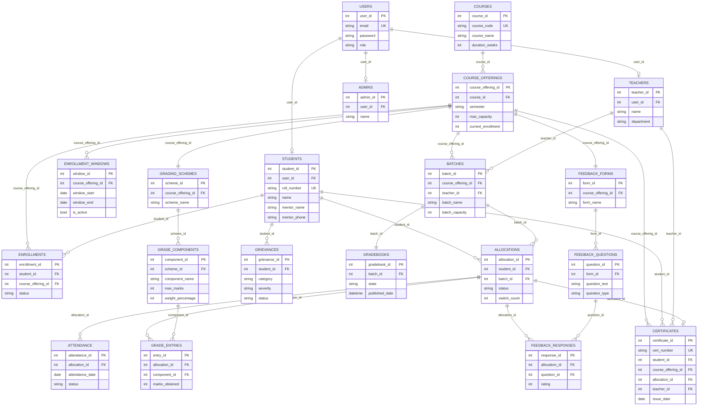

# UML — Entity Relationship Diagram

## Overview

Mermaid `erDiagram` rendering of the physical schema in [Database Design](../SDD/02-Database-Design.md). This supersedes the ASCII-art diagram in that document as the authoritative visual reference; the ASCII diagram there has been simplified to a summary sketch that points here. No entity, attribute, or relationship below was added beyond what Database Design already specifies — per the required fix, there is no `Mentor` entity; `mentor_name` and `mentor_phone` are attributes on `STUDENTS`.

## Notes

- `USERS ||--o| STUDENTS` etc. use a zero-or-one notation because a `Users` row can belong to exactly one of Students/Teachers/Admins depending on `role`, never more than one.
- `COURSE_OFFERINGS ||--o| CERTIFICATES` type relationships that fan out from a 1-side entity to `CERTIFICATES` are shown from the three FKs `CERTIFICATES` actually holds (`student_id`, `course_offering_id`, `allocation_id`, `teacher_id`) — all four are real foreign keys on the table per [Database Design §4.16](../SDD/02-Database-Design.md#416-certificates-table).
- See [Class Diagram §Notes](02-Class-Diagram.md#notes) for the same caveat on the undocumented `SwitchRequest` concept — it is not included here for the same reason.

## Related Documents

- [Database Design](../SDD/02-Database-Design.md) — authoritative table definitions, indexes, and constraints
- [Class Diagram](02-Class-Diagram.md)
