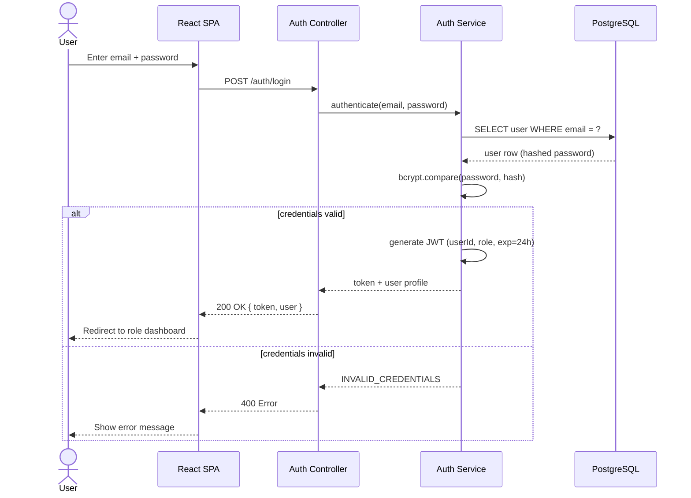
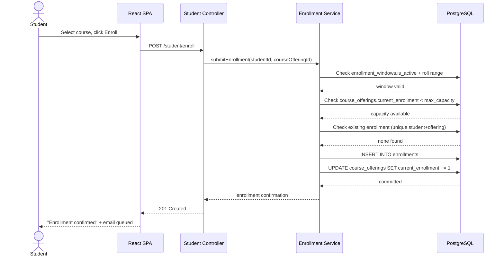
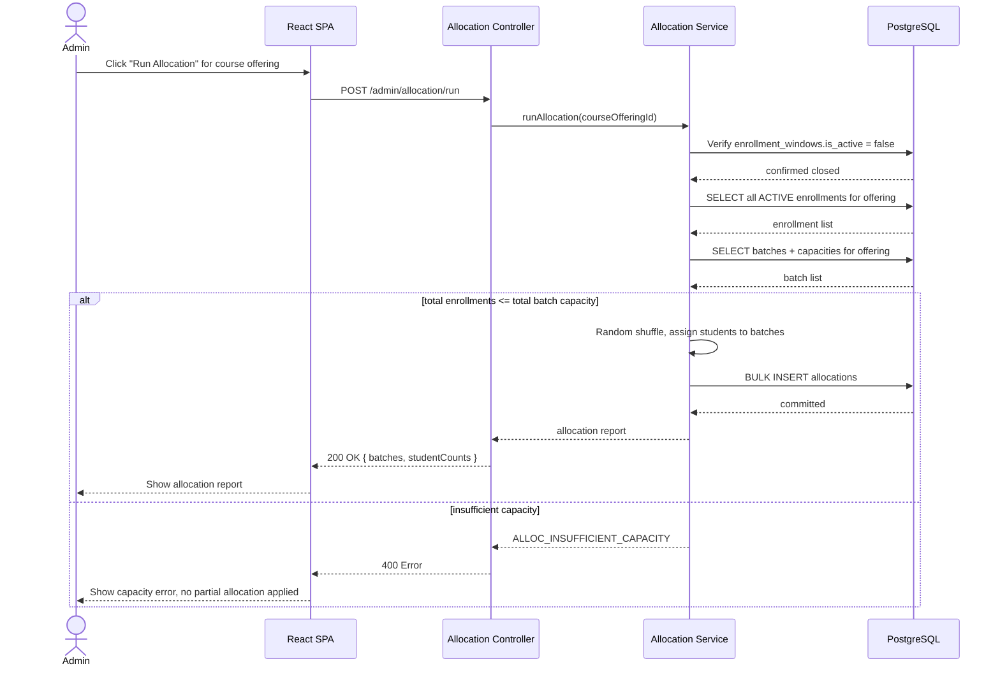
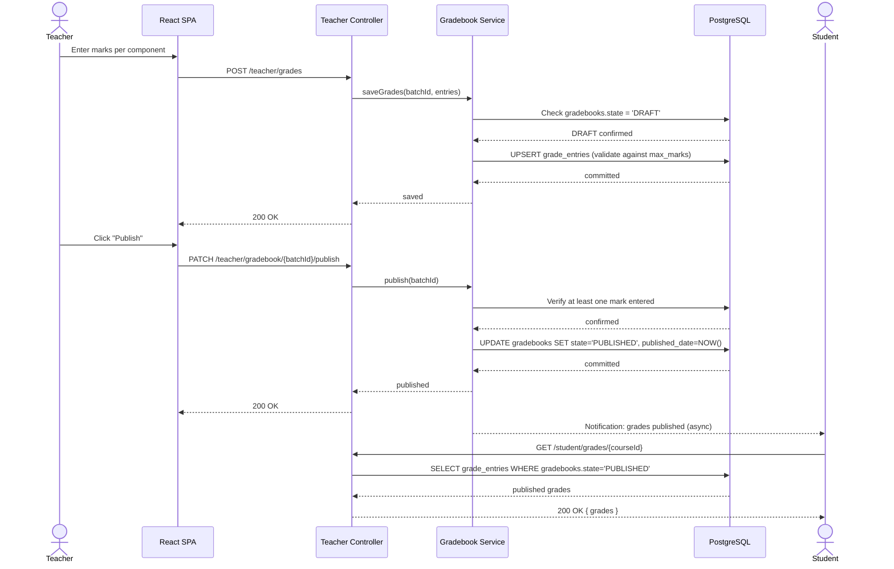
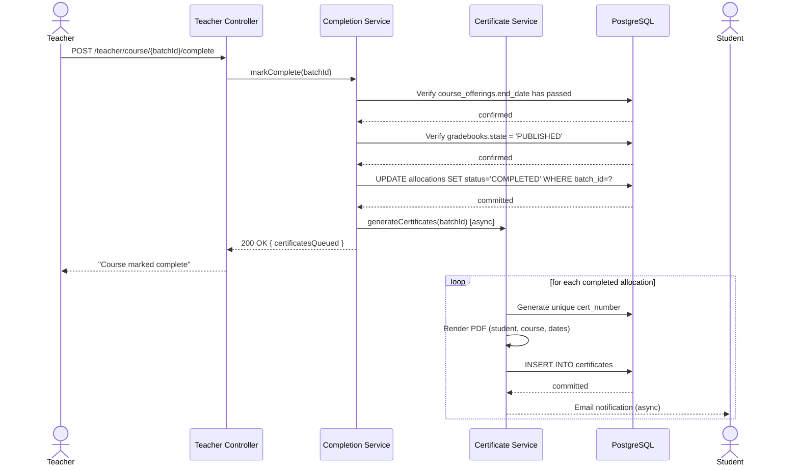

# UML — Sequence Diagrams

## Overview

Key end-to-end sequences, reflecting the flows already described in prose in [Authentication API](../API/Authentication.md), [Enrollment Design](../SDD/04-Enrollment-Design.md), [Batch Allocation](../SDD/05-Batch-Allocation.md), [Teacher Workspace](../SDD/06-Teacher-Workspace.md), and [Certificate Workflow](../SDD/10-Certificate-Workflow.md).

## 1. Login

## 2. Student Enrollment

## 3. Batch Allocation Run

## 4. Grade Entry & Publish

## 5. Course Completion → Certificate Generation

## Related Documents

- [Authentication API](../API/Authentication.md)
- [Enrollment Design](../SDD/04-Enrollment-Design.md)
- [Batch Allocation](../SDD/05-Batch-Allocation.md)
- [Teacher Workspace](../SDD/06-Teacher-Workspace.md)
- [Certificate Workflow](../SDD/10-Certificate-Workflow.md)
- [Activity Diagrams](05-Activity-Diagrams.md)
