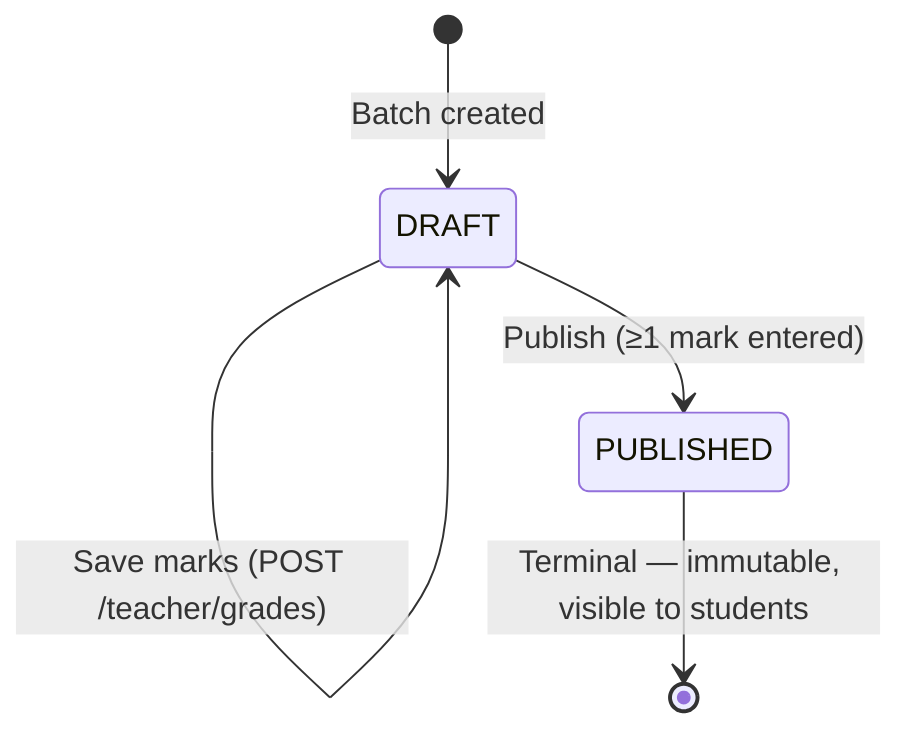
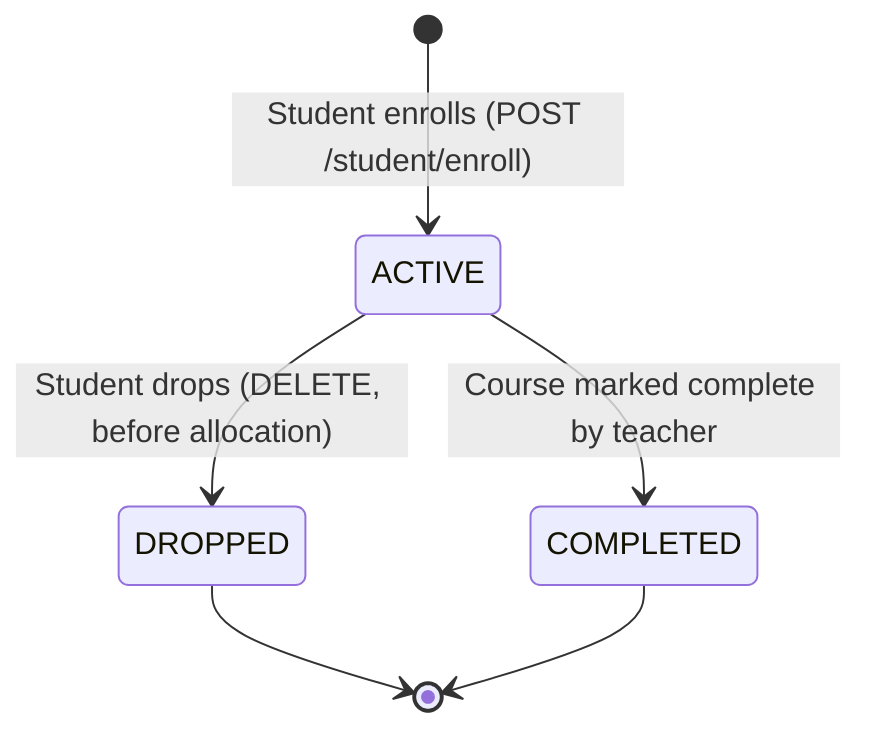
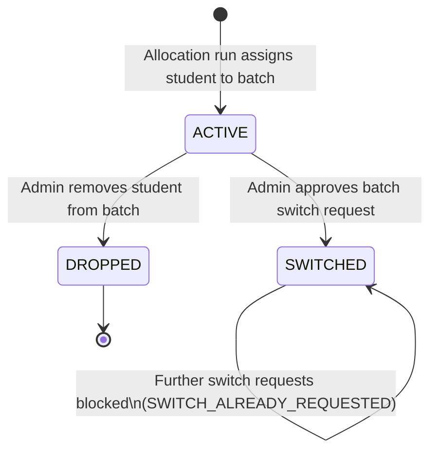
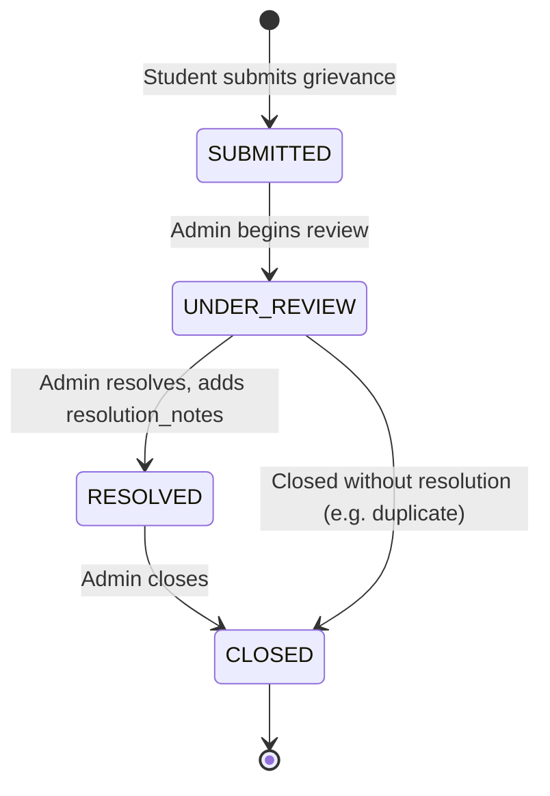
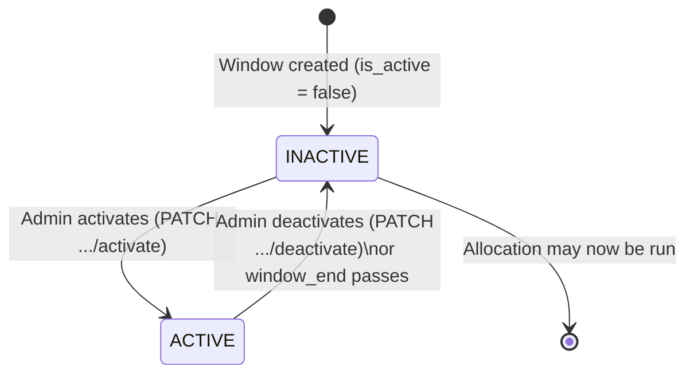

# UML — State Diagrams

## Overview

State machines for every stateful entity documented in [Database Design](../SDD/02-Database-Design.md) (fields with a bounded set of string values) and the module design docs that describe their transition rules.

## 1. Gradebook State

Source: `gradebooks.state` — [Database Design §4.15](../SDD/02-Database-Design.md#415-gradebook-table), [Teacher Workspace §6](../SDD/06-Teacher-Workspace.md#6-gradebook-sub-module).

## 2. Enrollment Status

Source: `enrollments.status` — [Database Design §4.8](../SDD/02-Database-Design.md#48-enrollments-table).

## 3. Allocation Status

Source: `allocations.status` — [Database Design §4.10](../SDD/02-Database-Design.md#410-allocations-table), [Batch Allocation](../SDD/05-Batch-Allocation.md).

## 4. Grievance Status

Source: `grievances.status` — [Database Design §4.20](../SDD/02-Database-Design.md#420-grievances-table).

## 5. Enrollment Window Activation

Source: `enrollment_windows.is_active` — [Database Design §4.7](../SDD/02-Database-Design.md#47-enrollmentwindows-table), [Admin Dashboard §5](../SDD/08-Admin-Dashboard.md#5-course-offering-seat--batch-configuration).

## Related Documents

- [Database Design](../SDD/02-Database-Design.md)
- [Teacher Workspace](../SDD/06-Teacher-Workspace.md)
- [Batch Allocation](../SDD/05-Batch-Allocation.md)
- [Activity Diagrams](05-Activity-Diagrams.md)
