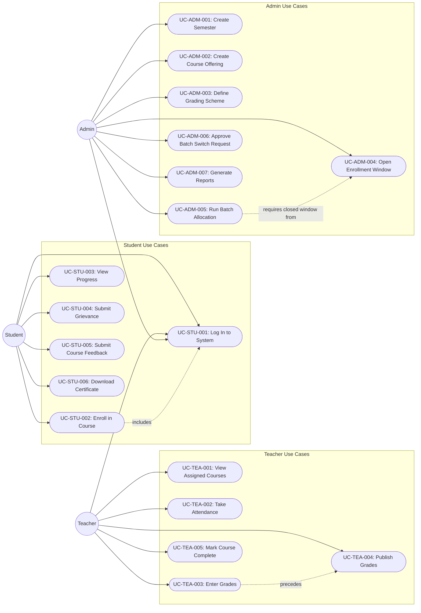

# UML — Use Case Diagram

## Overview

Mermaid rendering of the use cases documented in [Use Cases](../SRS/07-Use-Cases.md). Mermaid has no native use-case diagram type, so actors are modeled as nodes and use cases as stadium-shaped nodes inside actor-scoped subgraphs, matching the UC-ID naming from the SRS.

## Notes

- **Log In (UC-STU-001)** is shared by all three roles — a single authentication flow gated by role stored on the JWT (see [RBAC Design](../SDD/03-RBAC-Design.md)).
- **UC-TEA-003 → UC-TEA-004** (`precedes`): grades must be entered in Draft state before they can be published — see [Teacher Workspace §6](../SDD/06-Teacher-Workspace.md#6-gradebook-sub-module).
- **UC-ADM-005 → UC-ADM-004** (`requires closed window from`): batch allocation can only run after its enrollment window is deactivated — see [Batch Allocation](../SDD/05-Batch-Allocation.md).
- Full pre/post-conditions and flows for every use case are in [Use Cases](../SRS/07-Use-Cases.md); this diagram is a visual index, not a replacement for that document.

## Related Documents

- [Use Cases (SRS)](../SRS/07-Use-Cases.md)
- [RBAC Design](../SDD/03-RBAC-Design.md)
